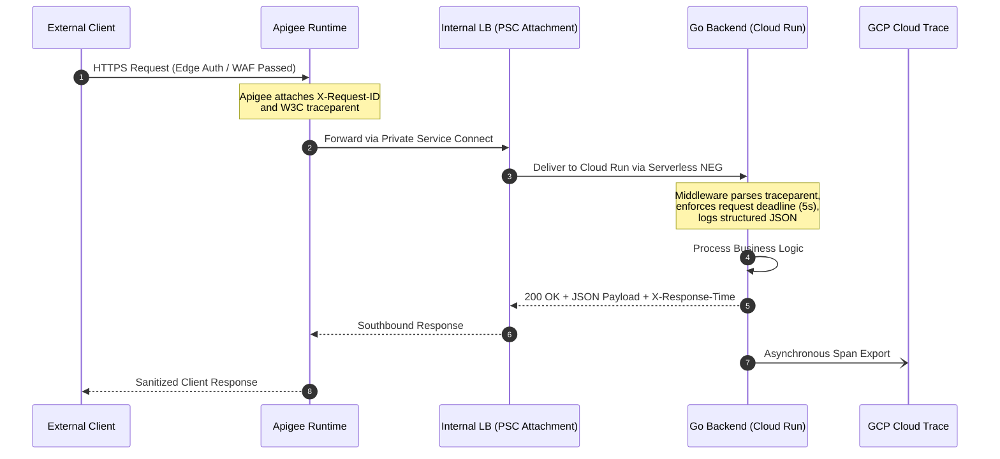

+++
title = "Project Plan 00 — Cloud Run Go Backend Service"
domain = "Golang"
tier = 3
topics = ["golang", "cloud-run", "backend", "psc", "distroless", "slog", "net-http"]
parent = "docs/Golang/README.md"
children = []
related = [
    "docs/architecture/CloudRun/CloudRun-requirements.md",
    "docs/architecture/architecture.md",
    "docs/decisions/architecture-decisions.md",
    "APPS/RAW-containers/RAW-hello-backend/README.md"
]
updated_by = "Antigravity AI"
version = "1.0"
+++

> **Parent**: [`docs/Golang/README.md`](file:///home/pochitawork/InterviewCloudProjects/ApigeeChallenge/docs/Golang/README.md)
> **Manifest**: [`AI_MANIFEST.toml`](file:///home/pochitawork/InterviewCloudProjects/ApigeeChallenge/AI_MANIFEST.toml)
> **Cloud Run Specs**: [`CloudRun-requirements.md`](file:///home/pochitawork/InterviewCloudProjects/ApigeeChallenge/docs/architecture/CloudRun/CloudRun-requirements.md)
> **Existing Baseline**: [`RAW-hello-backend`](file:///home/pochitawork/InterviewCloudProjects/ApigeeChallenge/APPS/RAW-containers/RAW-hello-backend/README.md)

<!-- AI RETRIEVAL HINTS:
- Purpose: Detailed technical design and implementation blueprint for implementing the Cloud Run backend service in Go.
- Questions Answered: How does the Go backend integrate with Private Service Connect (PSC)? How to replace the Node.js RAW-hello-backend? What are the health check, concurrency, and security requirements?
- When to Retrieve: Developing or refactoring the backend service on Cloud Run into Go.
-->

# Project 00 — Cloud Run Go Backend Service

## 1. Problem Statement & Strategic Fit

The current backend service in `APPS/RAW-containers/RAW-hello-backend` is implemented in Node.js. While functional, migrating this service to **idiomatic Go** provides substantial advantages for cloud infrastructure portfolios:
1. **Sub-second Cold Starts & Minimal Memory Footprint**: A static Go binary in a scratch or distroless container starts in tens of milliseconds with memory usage under 20MB, compared to 80-150MB for Node.js runtimes.
2. **First-Class Concurrency**: Native Goroutines allow high request throughput on minimal CPU allocations (0.5 to 1 vCPU).
3. **Strong Typing & Zero-Vulnerability Base Images**: Eliminates runtime Node dependencies and npm vulnerability bloat.
4. **Preserved Architecture**: Does not alter the established Apigee Non-VPC Peering, Private Service Connect (PSC), or Cloud Armor security boundaries.

---

## 2. Architectural Boundaries & Data Flow



### Southbound Integration Constraints
- **Listen Port**: Configurable via `PORT` environment variable (Cloud Run default `8080`).
- **Health & Readiness Endpoints**: Must expose `/healthz` (liveness) and `/ready` (readiness) for load balancer health probes and container startup.
- **Header Propagation**: Must ingest and correlate `X-Request-ID`, `X-Forwarded-For`, and `traceparent` (W3C standard) or `X-Cloud-Trace-Context`.
- **Graceful Shutdown**: Intercept `SIGTERM` and `SIGINT` to allow in-flight requests 10 seconds to drain before exiting.

---

## 3. Component Design & Directory Structure

Proposed location: `backend/go/`

```text
backend/go/
├── cmd/
│   └── server/
│       └── main.go               # Program entry point, signal trapping, server lifecycle
├── internal/
│   ├── api/
│   │   ├── handlers.go           # REST handlers (/api/v1/hello, /api/v1/data)
│   │   ├── health.go             # /healthz and /ready handlers
│   │   ├── middleware.go         # Request logging, recovery, request ID, timeout
│   │   └── router.go             # Standard net/http ServeMux or Chi router
│   ├── config/
│   │   └── config.go             # Environment parsing (PORT, TIMEOUT, LOG_LEVEL)
│   └── telemetry/
│       └── tracer.go             # OpenTelemetry SDK tracer initialization
├── Dockerfile                    # Multistage distroless build
├── go.mod
├── go.sum
└── README.md
```

---

## 4. Key Implementation Patterns

### 4.1 Configuration Loading
```go
type Config struct {
    Port            string        `env:"PORT" default:"8080"`
    ShutdownTimeout time.Duration `env:"SHUTDOWN_TIMEOUT" default:"10s"`
    RequestTimeout  time.Duration `env:"REQUEST_TIMEOUT" default:"5s"`
    LogLevel        string        `env:"LOG_LEVEL" default:"INFO"`
    Environment     string        `env:"ENV" default:"production"`
}
```

### 4.2 Structured Logging with Trace Correlation (`log/slog`)
Cloud Logging correlates log entries with Cloud Trace if the trace ID is injected into the JSON payload under `logging.googleapis.com/trace`:

```go
func LoggingMiddleware(projectID string) func(http.Handler) http.Handler {
    return func(next http.Handler) http.Handler {
        return http.HandlerFunc(func(w http.ResponseWriter, r *http.Request) {
            traceID := extractTraceID(r)
            logger := slog.With(
                "logging.googleapis.com/trace", fmt.Sprintf("projects/%s/traces/%s", projectID, traceID),
                "http.method", r.Method,
                "http.path", r.URL.Path,
                "http.user_agent", r.UserAgent(),
            )
            ctx := context.WithValue(r.Context(), loggerKey, logger)
            next.ServeHTTP(w, r.WithContext(ctx))
        })
    }
}
```

### 4.3 Containerization (`Dockerfile`)
```dockerfile
# Stage 1: Build binary
FROM golang:1.23-alpine AS builder
WORKDIR /app
COPY go.mod go.sum ./
RUN go mod download
COPY . .
RUN CGO_ENABLED=0 GOOS=linux GOARCH=amd64 go build \
    -ldflags="-s -w -X main.version=1.0.0" \
    -o /app/server ./cmd/server

# Stage 2: Minimal runtime
FROM gcr.io/distroless/static-debian12:nonroot
USER nonroot:nonroot
COPY --from=builder /app/server /server
EXPOSE 8080
ENTRYPOINT ["/server"]
```

---

## 5. Verification & Test Strategy

### Unit Tests
- Table-driven tests for handler response codes and JSON schemas.
- Middleware tests verifying panic recovery and header injection.
- Timeout propagation tests ensuring contexts cancel downstream operations.

### Integration & Concurrency Tests
- Benchmark test simulating 1,000 concurrent requests:
  ```bash
  go test -bench=. -benchmem ./...
  ```
- Race detector validation:
  ```bash
  go test -race ./...
  ```

### Manual Verification on Cloud Run
1. Build and push container to Google Artifact Registry.
2. Deploy revision with 0.5 vCPU and 256MB RAM:
   ```bash
   gcloud run deploy apigee-go-backend \
     --image=us-central1-docker.pkg.dev/${PROJECT_ID}/backend/go-service:v1 \
     --ingress=internal-and-cloud-load-balancing \
     --no-allow-unauthenticated
   ```
3. Verify PSC connection from Apigee by invoking the public ALB endpoint.

---

## 6. Portfolio Evidence Deliverables

- **ADR 001**: Decision Record comparing Go vs Node.js for Cloud Run backend services (memory, cold start, cold-to-warm latency).
- **Benchmark Report**: Requests per second (RPS) vs CPU utilization comparing Go vs Node.js.
- **Trace Visualization**: Screenshot showing full distributed trace from Apigee to Cloud Run in Google Cloud Trace.
