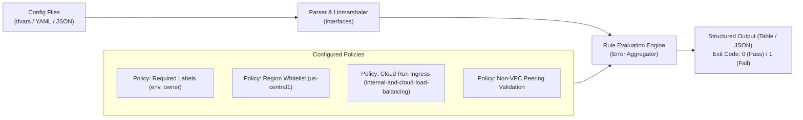

+++
title = "Project Plan 01 — Cloud Configuration Validator (Project 02)"
domain = "Golang"
tier = 3
topics = ["golang", "cli", "validation", "policy-as-code", "terraform", "cloud-run"]
parent = "docs/Golang/README.md"
children = []
related = [
    "docs/architecture/architecture.md",
    "docs/decisions/architecture-decisions.md",
    "platform/GCP/terraform/"
]
updated_by = "Antigravity AI"
version = "1.0"
+++

> **Parent**: [`docs/Golang/README.md`](file:///home/pochitawork/InterviewCloudProjects/ApigeeChallenge/docs/Golang/README.md)
> **Manifest**: [`AI_MANIFEST.toml`](file:///home/pochitawork/InterviewCloudProjects/ApigeeChallenge/AI_MANIFEST.toml)
> **Roadmap Ref**: Project 02 in [`golang_cloud_platform_portfolio_roadmap.md`](file:///home/pochitawork/InterviewCloudProjects/golang_cloud_platform_portfolio_roadmap.md)

<!-- AI RETRIEVAL HINTS:
- Purpose: Technical plan and specification for a Go-based configuration validator CLI for Apigee and GCP Terraform/manifest assets.
- Questions Answered: How to validate deployment configs and prevent misconfigurations prior to running Terraform or Cloud Run deployments?
- When to Retrieve: Designing pre-flight validation, CI linting, or policy enforcement tools.
-->

# Project 01 — Cloud Configuration Validator (Project 02)

## 1. Problem Statement & Strategic Fit

Cloud deployments frequently fail or introduce security vulnerabilities due to simple configuration oversights: missing labels, unapproved regions, unauthenticated Cloud Run endpoints, or invalid CIDR blocks.

While tools like `terraform validate` verify HCL syntax, they do not enforce **organizational architectural policies** (e.g., ensuring Apigee instances are strictly non-VPC peering, or Cloud Run ingress is restricted to Internal & Cloud Load Balancing).

This project implements a standalone, fast Go CLI (`cloud-validator`) that performs static analysis on environment manifests, Terraform variable files (`*.tfvars`, `*.tfvars.json`), and service manifests before infrastructure provisioning.

---

## 2. Scope & Policy Rule Engine



### In-Scope Policy Validations:
1. **Cloud Run Security**: Verify `ingress` setting is strictly `internal-and-cloud-load-balancing` and `allow_unauthenticated = false`.
2. **Approved GCP Regions**: Block any deployment targeting regions outside approved boundaries (e.g., only `us-central1`).
3. **Mandatory Resource Labels**: Enforce `environment`, `project_owner`, `cost_center`, and `managed_by = "terraform"`.
4. **Network & CIDR Constraints**: Validate that PSC subnet ranges do not overlap with reserved internal ranges.
5. **Apigee Topology**: Ensure Apigee organization configs declare `RUNTIME_TYPE = CLOUD` and Peering Type is non-VPC peering.

---

## 3. Component Architecture & Directory Structure

Proposed location: `tools/cloud-validator/`

```text
tools/cloud-validator/
├── cmd/
│   └── cloud-validator/
│       └── main.go               # Cobra CLI entry point
├── internal/
│   ├── config/                   # CLI flags and rule configuration
│   ├── parser/
│   │   ├── hcl_parser.go         # Parsing .tfvars / HCL variables
│   │   ├── json_parser.go        # JSON manifest parser
│   │   └── yaml_parser.go        # YAML environment parser
│   ├── rules/
│   │   ├── rule.go               # Evaluator interface
│   │   ├── labels_rule.go        # Enforce required labels
│   │   ├── network_rule.go       # CIDR and non-overlapping subnet checks
│   │   └── security_rule.go      # Cloud Run auth and ingress checks
│   ├── reporter/
│   │   ├── console.go            # Colorized terminal table reporter
│   │   └── json.go               # Machine-readable JSON output for CI
│   └── testdata/                 # Positive and negative fixtures
├── go.mod
├── go.sum
└── README.md
```

---

## 4. Key Implementation Patterns

### 4.1 Extensible Rule Interface
```go
package rules

type Violation struct {
    File     string   `json:"file"`
    Field    string   `json:"field"`
    Severity string   `json:"severity"` // ERROR, WARNING
    Message  string   `json:"message"`
    Remedy   string   `json:"remedy"`
}

type Rule interface {
    Name() string
    Description() string
    Evaluate(manifest *parser.TargetConfig) []Violation
}
```

### 4.2 Error Aggregation
Unlike basic checkers that fail on the first error, the evaluator executes all rules across all supplied files and aggregates all violations before determining the exit code:

```go
type AggregatedErrors struct {
    Violations []Violation
}

func (a *AggregatedErrors) HasErrors() bool {
    for _, v := range a.Violations {
        if v.Severity == "ERROR" {
            return true
        }
    }
    return false
}
```

### 4.3 CLI Usage Pattern
```bash
# Validate production terraform variables
cloud-validator validate --target=platform/GCP/terraform/environments/prod.tfvars

# Validate in CI with JSON output
cloud-validator validate --dir=platform/GCP/terraform/ --output=json
```

---

## 5. Verification & Test Strategy

### Automated Unit Tests
- Create positive test fixtures (`valid-prod.tfvars`, `valid-service.yaml`) that pass with zero violations.
- Create negative fixtures (`invalid-region.tfvars`, `public-ingress-run.yaml`) that trigger specific violations.
- Verify exit code behavior: `0` when clean, `1` when violations of severity `ERROR` are detected.

### CI Integration Test
- Add a GitHub Actions / Cloud Build step that runs `cloud-validator` on all pull requests touching `platform/GCP/terraform/`.

---

## 6. Portfolio Evidence Deliverables

- **CLI Demo Output**: Clean ASCII table showing detected violations with line numbers and remediations.
- **CI Blocking Evidence**: Pull request screenshot or log showing a simulated misconfiguration blocked by `cloud-validator`.
- **ADR 002**: Architectural Decision Record on choosing Go vs Python for infrastructure validation tools (binary distribution, startup speed, type guarantees).
