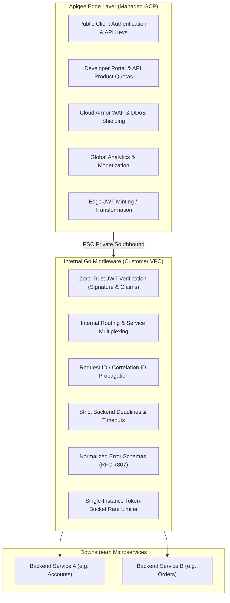

+++
title = "Project Plan 02 — Go API Gateway / Middleware (Project 06)"
domain = "Golang"
tier = 3
topics = ["golang", "api-gateway", "middleware", "jwt", "reverse-proxy", "apigee"]
parent = "docs/Golang/README.md"
children = []
related = [
    "docs/architecture/architecture.md",
    "docs/decisions/architecture-decisions.md",
    "APPS/APIgee/"
]
updated_by = "Antigravity AI"
version = "1.0"
+++

> **Parent**: [`docs/Golang/README.md`](file:///home/pochitawork/InterviewCloudProjects/ApigeeChallenge/docs/Golang/README.md)
> **Manifest**: [`AI_MANIFEST.toml`](file:///home/pochitawork/InterviewCloudProjects/ApigeeChallenge/AI_MANIFEST.toml)
> **Roadmap Ref**: Project 06 in [`golang_cloud_platform_portfolio_roadmap.md`](file:///home/pochitawork/InterviewCloudProjects/golang_cloud_platform_portfolio_roadmap.md)

<!-- AI RETRIEVAL HINTS:
- Purpose: Architectural design and blueprint for specialized Go API routing and middleware behind Apigee.
- Questions Answered: What responsibilities stay in Apigee vs what moves to Go middleware? How to build a fast, secure HTTP reverse proxy in Go?
- When to Retrieve: Designing microservice routing, internal authentication, or intermediate proxy layers.
-->

# Project 02 — Go API Gateway / Middleware (Project 06)

## 1. Problem Statement & Strategic Fit

In modern enterprise architectures, the edge API Management platform (Apigee) is paired with internal micro-gateways or routing middleware to decouple edge concerns from internal service mesh/backend logic.

While Apigee excels at public API contracts, developer self-service, API products, and OAuth token exchanges, an internal Go middleware service provides:
1. **Low-Latency Backend Multiplexing**: Fast internal routing between multiple microservices without requiring repetitive Apigee target endpoint updates.
2. **Zero-Trust Identity Validation**: Validates cryptographic claims (OIDC / JWT assertions) issued by Apigee or GCP before traffic reaches domain business logic.
3. **Resilient Downstream Dispatch**: Granular backend timeouts, retry policies, and structured error responses.

---

## 2. Apigee Edge vs Go Middleware Boundary Demarcation

An essential deliverable for this project is a clear **Responsibility Boundary Matrix**:



| Responsibility | Apigee Edge Layer | Go Internal Middleware |
|---|---|---|
| **Public API Authentication** | **Primary** (API keys, OAuth2, SAML) | N/A (Internal trust domain) |
| **Edge Threat Protection** | **Primary** (Cloud Armor, XML/JSON Threat) | N/A |
| **Internal JWT Validation** | Minting / Edge validation | **Primary** (Verifies Apigee-issued claims) |
| **Backend Routing & Dispatch** | Southbound target endpoint definition | **Primary** (Dynamic path/header dispatch) |
| **Payload Normalization** | Optional | **Primary** (Standard JSON error envelopes) |
| **Backend Timeouts & Deadlines** | Broad proxy timeout | **Primary** (Context deadlines per route) |

---

## 3. Component Architecture & Directory Structure

Proposed location: `tools/api-gateway/` or `backend/go/internal/gateway/`

```text
tools/api-gateway/
├── cmd/
│   └── gateway/
│       └── main.go               # Program entry point, TLS, server lifecycle
├── internal/
│   ├── auth/
│   │   ├── jwt_validator.go      # Go-jose / golang-jwt validator with key caching
│   │   └── claims.go             # Custom claim schema & context injection
│   ├── proxy/
│   │   ├── reverse_proxy.go      # httputil.ReverseProxy wrapper with Director
│   │   ├── router.go             # Route matching based on headers/paths
│   │   └── timeout.go            # Per-route context deadline enforcer
│   ├── ratelimit/
│   │   └── memory_limiter.go     # In-memory token bucket (golang.org/x/time/rate)
│   ├── middleware/
│   │   ├── request_id.go         # X-Request-ID propagation & generation
│   │   ├── logger.go             # Redacted slog middleware (no tokens logged)
│   │   └── recovery.go           # Panic handler returning RFC 7807 problem details
│   └── config/
│       └── routes.yaml           # Routing table & upstream definitions
├── go.mod
├── go.sum
└── README.md
```

---

## 4. Key Implementation Patterns

### 4.1 Reverse Proxy with Context Deadlines
```go
func NewProxy(targetURL *url.URL, timeout time.Duration) *httputil.ReverseProxy {
    proxy := httputil.NewSingleHostReverseProxy(targetURL)
    originalDirector := proxy.Director
    
    proxy.Director = func(req *http.Request) {
        originalDirector(req)
        // Ensure request ID travels downstream
        if reqID := req.Header.Get("X-Request-ID"); reqID != "" {
            req.Header.Set("X-Correlation-ID", reqID)
        }
    }
    
    proxy.Transport = &http.Transport{
        ResponseHeaderTimeout: timeout,
        MaxIdleConns:          100,
        IdleConnTimeout:       90 * time.Second,
    }
    
    return proxy
}
```

### 4.2 Security: Redaction of Bearer Tokens in Logs
```go
func SanitizeHeaders(h http.Header) map[string]string {
    sanitized := make(map[string]string)
    for k, v := range h {
        if strings.EqualFold(k, "Authorization") || strings.EqualFold(k, "X-Api-Key") {
            sanitized[k] = "[REDACTED]"
        } else {
            sanitized[k] = strings.Join(v, ",")
        }
    }
    return sanitized
}
```

---

## 5. Verification & Test Strategy

### Automated Unit & Integration Tests
- **JWT Validation Test**: Test valid, expired, wrong issuer, and tampered tokens against a mock JWKS server.
- **Backend Down Simulation**: Verify that when downstream is unreachable, gateway returns `503 Service Unavailable` with RFC 7807 problem details within 50ms without hanging.
- **Timeout Test**: Downstream delay of 5s against a 2s timeout must trigger `504 Gateway Timeout`.

---

## 6. Portfolio Evidence Deliverables

- **Architecture Boundary Diagram**: Visual map illustrating Apigee vs. Go Gateway responsibilities.
- **Security Benchmark Report**: Latency overhead of Go JWT validation (< 1ms per request).
- **ADR 003**: Why an internal Go gateway complements Apigee rather than replaces it.
