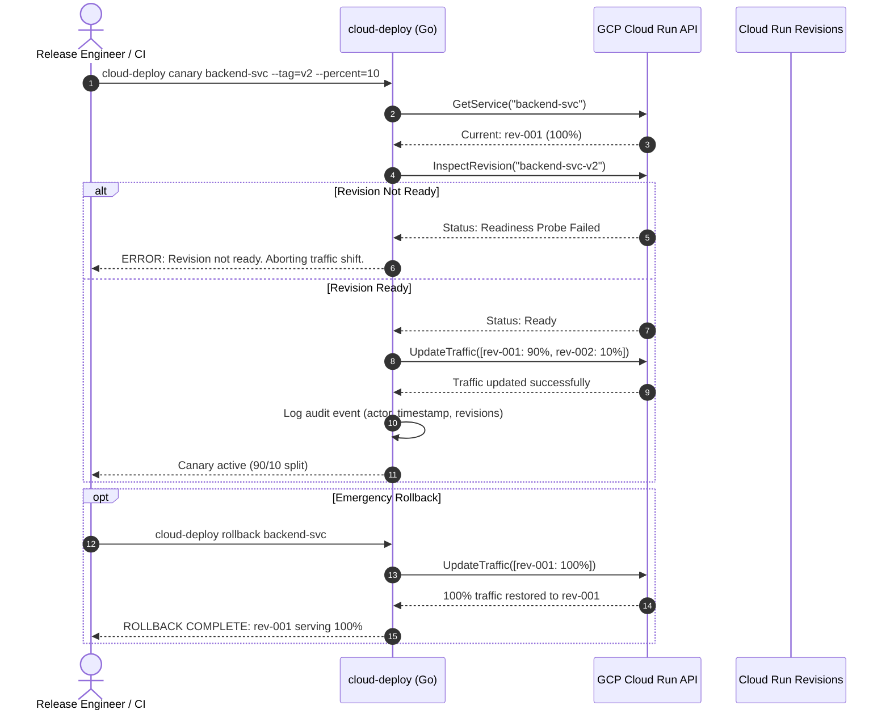

+++
title = "Project Plan 03 — Cloud Run Deployment Manager (Project 08)"
domain = "Golang"
tier = 3
topics = ["golang", "cloud-run", "deployment", "canary", "rollback", "gcp-sdk"]
parent = "docs/Golang/README.md"
children = []
related = [
    "docs/architecture/CloudRun/CloudRun-requirements.md",
    "docs/operations/deployment-runbook.md",
    "platform/GCP/terraform/"
]
updated_by = "Antigravity AI"
version = "1.0"
+++

> **Parent**: [`docs/Golang/README.md`](file:///home/pochitawork/InterviewCloudProjects/ApigeeChallenge/docs/Golang/README.md)
> **Manifest**: [`AI_MANIFEST.toml`](file:///home/pochitawork/InterviewCloudProjects/ApigeeChallenge/AI_MANIFEST.toml)
> **Roadmap Ref**: Project 08 in [`golang_cloud_platform_portfolio_roadmap.md`](file:///home/pochitawork/InterviewCloudProjects/golang_cloud_platform_portfolio_roadmap.md)

<!-- AI RETRIEVAL HINTS:
- Purpose: Technical blueprint for a Go CLI orchestrating safe Cloud Run revision traffic management, canary rollouts, and instant rollbacks.
- Questions Answered: How to safely shift traffic between Cloud Run revisions? How to automate canary rollouts and instant rollbacks using GCP APIs?
- When to Retrieve: Designing release management tools or investigating deployment automation.
-->

# Project 03 — Cloud Run Deployment Manager (Project 08)

## 1. Problem Statement & Strategic Fit

Deploying new backend revisions directly to 100% traffic carries significant operational risk. If a new container image fails health probes or encounters runtime crashes, users immediately experience service degradation.

Google Cloud Run natively supports multi-revision traffic splitting, but managing canary percentages, validating revision health, and executing rapid rollbacks via raw `gcloud` or Terraform can be slow or error-prone during an incident.

This project implements `cloud-deploy`, a targeted Go CLI that uses the official Google Cloud Run API client to:
- Inspect active and historic revisions.
- Verify revision readiness before directing user traffic.
- Execute graduated canary rollouts (e.g., 10% -> 50% -> 100%).
- Roll back traffic instantly to the previous known-good revision upon failure.
- Record an audit trail of all traffic mutations.

---

## 2. Release & Rollback Sequence



---

## 3. Component Architecture & Directory Structure

Proposed location: `tools/cloud-deploy/`

```text
tools/cloud-deploy/
├── cmd/
│   └── cloud-deploy/
│       └── main.go               # Cobra root command & subcommands (status, canary, rollback)
├── internal/
│   ├── gcp/
│   │   ├── client.go             # Cloud Run client wrapper (cloud.google.com/go/run)
│   │   └── auth.go               # GCP Application Default Credentials handler
│   ├── deployer/
│   │   ├── inspector.go          # Retrieve revisions and status
│   │   ├── traffic.go            # Traffic allocation and validation
│   │   └── rollback.go           # Rollback logic locating last known-good revision
│   ├── audit/
│   │   └── logger.go             # Local and Cloud Logging audit record writer
│   └── models/
│       └── service.go            # Domain representations of Service and Revisions
├── go.mod
├── go.sum
└── README.md
```

---

## 4. Key Implementation Patterns

### 4.1 CLI Commands Overview
```bash
# Check status and current traffic distribution
cloud-deploy status apigee-go-backend --region=us-central1

# Start a canary release: route 10% to new revision
cloud-deploy canary apigee-go-backend --revision=apigee-go-backend-00004-xyz --percent=10

# Promote canary to 100%
cloud-deploy promote apigee-go-backend --revision=apigee-go-backend-00004-xyz

# Instant one-command rollback to previous stable revision
cloud-deploy rollback apigee-go-backend
```

### 4.2 Traffic Shifting Implementation (GCP SDK)
```go
func (d *Deployer) ShiftTraffic(ctx context.Context, serviceName string, splits map[string]int32) error {
    req := &runpb.GetServiceRequest{Name: serviceName}
    svc, err := d.client.GetService(ctx, req)
    if err != nil {
        return fmt.Errorf("failed to fetch service %s: %w", serviceName, err)
    }

    var trafficAllocations []*runpb.TrafficTarget
    var totalPercent int32
    for rev, pct := range splits {
        totalPercent += pct
        trafficAllocations = append(trafficAllocations, &runpb.TrafficTarget{
            Revision: rev,
            Percent:  pct,
        })
    }

    if totalPercent != 100 {
        return fmt.Errorf("traffic percentages must sum to 100, got %d", totalPercent)
    }

    svc.Traffic = trafficAllocations
    updateReq := &runpb.UpdateServiceRequest{Service: svc}
    _, err = d.client.UpdateService(ctx, updateReq)
    return err
}
```

---

## 5. Verification & Test Strategy

### Unit Tests
- Mock the Cloud Run API client using generated interface doubles.
- Test traffic percentage boundary conditions (reject sums != 100%, negative percentages).
- Test rollback resolution when multiple historical revisions exist.

### Integration Test (Disposable Cloud Run Service)
- Deploy test service with dummy revisions.
- Execute `canary 20`, verify GCP API reflects 80/20 split.
- Execute `rollback`, verify GCP API immediately reflects 100% on base revision.

---

## 6. Portfolio Evidence Deliverables

- **CLI Demo Execution**: Recorded or markdown terminal output demonstrating status inspection, canary split, and rollback.
- **Rollback Runbook**: Clear SRE procedure documenting mean time to recovery (MTTR < 10 seconds) during incident response.
- **ADR 004**: Architectural Decision Record on client-side deployment orchestration vs. relying solely on CD pipelines.
