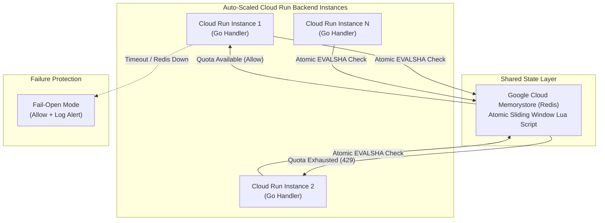

+++
title = "Project Plan 04 — Distributed Rate Limiter (Project 11)"
domain = "Golang"
tier = 3
topics = ["golang", "rate-limiter", "redis", "memorystore", "distributed-systems", "concurrency"]
parent = "docs/Golang/README.md"
children = []
related = [
    "docs/architecture/architecture.md",
    "docs/Golang/02-go-api-gateway-middleware.md"
]
updated_by = "Antigravity AI"
version = "1.0"
+++

> **Parent**: [`docs/Golang/README.md`](file:///home/pochitawork/InterviewCloudProjects/ApigeeChallenge/docs/Golang/README.md)
> **Manifest**: [`AI_MANIFEST.toml`](file:///home/pochitawork/InterviewCloudProjects/ApigeeChallenge/AI_MANIFEST.toml)
> **Roadmap Ref**: Project 11 in [`golang_cloud_platform_portfolio_roadmap.md`](file:///home/pochitawork/InterviewCloudProjects/golang_cloud_platform_portfolio_roadmap.md)

<!-- AI RETRIEVAL HINTS:
- Purpose: Technical plan for implementing a high-throughput distributed rate limiting component backed by Redis / GCP Memorystore.
- Questions Answered: How to enforce shared request quotas across multiple Cloud Run instances? How to handle Redis outages gracefully (fail-open vs fail-closed)?
- When to Retrieve: Designing rate limiting, quota enforcement, or multi-tenant protection.
-->

# Project 04 — Distributed Rate Limiter (Project 11)

## 1. Problem Statement & Strategic Fit

When backend services run on auto-scaling serverless infrastructure like Cloud Run, individual instances cannot rely on local in-memory rate limiting alone to enforce aggregate tenant quotas. If 20 instances run concurrently, local limiters could allow up to 20x the intended quota to reach expensive downstream databases or third-party APIs.

While Apigee provides edge rate limiting via `SpikeArrest` and `Quota` policies, internal service-to-service calls or backend microservices require a **distributed, low-latency rate limiter** that:
1. Enforces consistent quotas across all Cloud Run backend instances.
2. Supports granular multi-tenant policies (per-customer, per-API-key, per-endpoint).
3. Defines explicit failure semantics (fail-open vs. fail-closed) when the caching layer suffers latency or outages.

---

## 2. Architecture & Algorithm Design



### Algorithm Selection: Sliding Window Log vs Sliding Window Counter
We select the **Sliding Window Counter** algorithm implemented via an atomic Redis Lua script:
- Provides near-perfect accuracy without the unbounded memory overhead of storing individual timestamp logs.
- Memory consumption: < 100 bytes per active key.
- Evaluation latency: Sub-millisecond (0.2–0.5ms over VPC peering or Serverless VPC Access).

---

## 3. Failure Semantics: Fail-Open vs Fail-Closed

An essential architectural requirement from the roadmap is documenting and testing outage behavior:

| Mode | Behavior during Redis Failure / Timeout | Justification for Apigee Challenge |
|---|---|---|
| **Fail-Open (Selected for Standard APIs)** | If Redis ping or evaluation exceeds 25ms, request is allowed through; increment error counter `rate_limiter_errors_total`. | Prevents a caching failure from causing a total outage of critical business APIs. |
| **Fail-Closed (Selected for Expensive / Paid APIs)** | If Redis is unreachable, request is rejected with `503 Service Unavailable` or `429 Too Many Requests`. | Protects paid downstream systems from catastrophic billing spikes during cache outages. |

---

## 4. Component Architecture & Directory Structure

Proposed location: `tools/rate-limiter/` or `pkg/ratelimiter/`

```text
pkg/ratelimiter/
├── limiter.go                 # Core Limiter interface (Allow, Take, Reserve)
├── redis_limiter.go           # Redis implementation using go-redis/v9
├── lua_scripts.go             # Embedded atomic Lua scripts
├── options.go                 # Configuration (Redis address, timeout, fail-mode)
├── memory_fallback.go         # Local fallback limiter if Redis drops
├── limiter_test.go            # Unit and race detection tests
└── benchmark_test.go          # Micro-benchmarks under high concurrency
```

---

## 5. Key Implementation Patterns

### 5.1 Atomic Lua Script (Sliding Window)
```lua
-- KEYS[1]: rate limit key (e.g. rate:tenant_123:orders)
-- ARGV[1]: window size in milliseconds
-- ARGV[2]: max allowed tokens in window
-- ARGV[3]: current timestamp in milliseconds
local key = KEYS[1]
local window = tonumber(ARGV[1])
local limit = tonumber(ARGV[2])
local now = tonumber(ARGV[3])
local clearBefore = now - window

redis.call('ZREMRANGEBYSCORE', key, 0, clearBefore)
local currentRequests = redis.call('ZCARD', key)

if currentRequests < limit then
    redis.call('ZADD', key, now, now)
    redis.call('PEXPIRE', key, window)
    return {1, limit - currentRequests - 1} -- Allowed, remaining
else
    return {0, 0} -- Denied, 0 remaining
end
```

### 5.2 Go Client with Context Timeout & Circuit Breaker
```go
func (r *RedisLimiter) Allow(ctx context.Context, key string, limit int, window time.Duration) (bool, error) {
    // Enforce strict 20ms timeout on Redis query
    evalCtx, cancel := context.WithTimeout(ctx, 20*time.Millisecond)
    defer cancel()

    now := time.Now().UnixMilli()
    res, err := r.script.Run(evalCtx, r.client, []string{key}, window.Milliseconds(), limit, now).Slice()
    if err != nil {
        if r.failOpen {
            slog.Warn("Rate limiter Redis failure; failing open", "error", err, "key", key)
            return true, nil // Fail open
        }
        return false, fmt.Errorf("rate limiter error: %w", err)
    }

    allowed := res[0].(int64) == 1
    return allowed, nil
}
```

---

## 6. Verification & Test Strategy

### Concurrency & Race Tests
- Run 50 Goroutines making 1,000 requests against a mock Redis miniredis instance:
  ```bash
  go test -race -v -run TestConcurrentRateLimiter
  ```
- Verify that exactly `Limit` requests succeed and remaining return `Allowed = false`.

### Chaos & Outage Test
- Terminate Redis connection mid-traffic.
- Verify system transitions smoothly to configured fail-open behavior without panicking or stalling requests.

---

## 7. Portfolio Evidence Deliverables

- **Benchmark Report**: Throughput (requests/sec) and latency profile (P50, P99) of Redis Lua evaluation.
- **Chaos Injection Results**: Evidence graph showing request success rates when Redis is restarted.
- **ADR 005**: Architecture Decision Record on Sliding Window algorithm selection vs Leaky Bucket.
