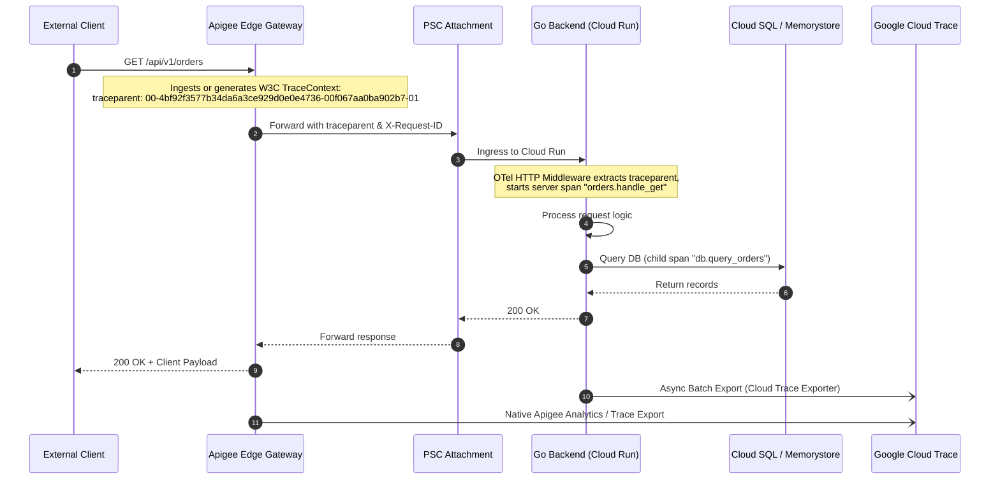

+++
title = "Project Plan 05 — OpenTelemetry Observability Integration (Project 12)"
domain = "Golang"
tier = 3
topics = ["golang", "opentelemetry", "cloud-trace", "observability", "distributed-tracing", "metrics"]
parent = "docs/Golang/README.md"
children = []
related = [
    "docs/architecture/architecture.md",
    "docs/operations/monitoring-and-logging.md",
    "docs/Golang/00-cloud-run-backend-go.md"
]
updated_by = "Antigravity AI"
version = "1.0"
+++

> **Parent**: [`docs/Golang/README.md`](file:///home/pochitawork/InterviewCloudProjects/ApigeeChallenge/docs/Golang/README.md)
> **Manifest**: [`AI_MANIFEST.toml`](file:///home/pochitawork/InterviewCloudProjects/ApigeeChallenge/AI_MANIFEST.toml)
> **Roadmap Ref**: Project 12 in [`golang_cloud_platform_portfolio_roadmap.md`](file:///home/pochitawork/InterviewCloudProjects/golang_cloud_platform_portfolio_roadmap.md)

<!-- AI RETRIEVAL HINTS:
- Purpose: Technical plan for integrating OpenTelemetry SDK tracing and metrics into the Go backend and Apigee request lifecycle.
- Questions Answered: How to trace an API request from Apigee Edge across Private Service Connect to Cloud Run and GCP dependencies?
- When to Retrieve: Designing observability, setting up Cloud Trace, or configuring distributed tracing.
-->

# Project 05 — OpenTelemetry Observability Integration (Project 12)

## 1. Problem Statement & Strategic Fit

When an API request traverses multiple networking layers—from an External Application Load Balancer through Cloud Armor, Apigee, Private Service Connect (PSC), an Internal Load Balancer, and into Cloud Run—diagnosing latency bottlenecks or intermittent errors without distributed tracing is nearly impossible.

Standard logs only reveal isolated snapshots. This project integrates the **OpenTelemetry (OTel) Go SDK** into the Apigee Challenge ecosystem to:
1. Connect Apigee edge traces with backend container executions using W3C `traceparent` headers.
2. Measure granular span latencies (e.g., PSC transit, handler execution, database/downstream calls).
3. Export telemetry seamlessly to **Google Cloud Trace** and **Google Cloud Monitoring** without adding blocking overhead to client requests.

---

## 2. Distributed Tracing Flow Across Hybrid Perimeter



---

## 3. Metrics Design & Cardinality Control

To avoid expensive billing or metric explosion, metrics are carefully scoped:

| Metric Name | Type | Unit | Dimensions (Labels) | Purpose |
|---|---|---|---|---|
| `http.server.request_duration` | Histogram | ms | `http.route`, `http.status_code`, `http.method` | Measures P50, P95, P99 request latency |
| `http.server.requests_total` | Counter | 1 | `http.route`, `http.status_code` | Measures API throughput and error rates |
| `http.client.downstream_duration` | Histogram | ms | `peer.service`, `http.status_code` | Isolates downstream dependency latency |

> [!WARNING]
> Never include high-cardinality attributes like `user_id`, `request_id`, or query string parameters in metric dimensions. These belong solely in trace span attributes.

---

## 4. Component Architecture & Directory Structure

Proposed location: `pkg/telemetry/`

```text
pkg/telemetry/
├── provider.go               # TracerProvider & MeterProvider initialization
├── trace_exporter.go         # Google Cloud Trace exporter (cloud.google.com/go/trace)
├── middleware.go             # net/http tracing middleware wrapping handlers
├── context.go                # Helpers to extract/inject trace IDs into slog
├── redaction.go              # Sanitizes PII and credentials from span attributes
└── telemetry_test.go         # Test span generation and context propagation
```

---

## 5. Key Implementation Patterns

### 5.1 Non-Blocking Tracer Initialization (GCP Exporter)
```go
package telemetry

import (
    "context"
    texporter "github.com/GoogleCloudPlatform/opentelemetry-operations-go/exporter/trace"
    "go.opentelemetry.io/otel"
    "go.opentelemetry.io/otel/propagation"
    sdktrace "go.opentelemetry.io/otel/sdk/trace"
)

func InitTelemetry(ctx context.Context, projectID string) (*sdktrace.TracerProvider, error) {
    exporter, err := texporter.New(texporter.WithProjectID(projectID))
    if err != nil {
        return nil, err
    }

    tp := sdktrace.NewTracerProvider(
        sdktrace.WithBatcher(exporter, sdktrace.WithBatchTimeout(5*time.Second)),
        sdktrace.WithSampler(sdktrace.ParentBased(sdktrace.TraceIDRatioBased(0.1))), // 10% sampling
    )

    otel.SetTracerProvider(tp)
    otel.SetTextMapPropagator(propagation.NewCompositeTextMapPropagator(
        propagation.TraceContext{}, // W3C
        propagation.Baggage{},
    ))

    return tp, nil
}
```

### 5.2 Resilient Telemetry: Never Block Client Traffic
Telemetry batchers run in the background. If the GCP Cloud Trace API is throttled or offline, spans are dropped asynchronously after internal buffers fill, ensuring zero impact on live HTTP latency.

---

## 6. Verification & Test Strategy

### Automated Unit Tests
- Test that middleware accurately extracts incoming W3C `traceparent` headers and binds them as parent spans.
- Verify that spans generated for error responses (`5xx`) carry `span.SetStatus(codes.Error, ...)`.
- Test data sanitization: confirm authorization headers and email addresses are filtered out of span tags.

### Manual Verification in Cloud Console
1. Send 10 test requests through the public Apigee endpoint.
2. Open **Google Cloud Trace > Trace Explorer**.
3. Confirm that the trace visualizes the complete lifecycle, displaying both the edge gateway span and the nested Cloud Run handler child spans.

---

## 7. Portfolio Evidence Deliverables

- **Trace Waterfall Diagram**: Screenshot showing an end-to-end trace with child spans.
- **Troubleshooting Case Study**: Documented scenario resolving an artificial 500ms downstream latency bottleneck using Cloud Trace evidence.
- **ADR 006**: Architecture Decision Record on selecting OpenTelemetry over vendor-specific tracing libraries.
