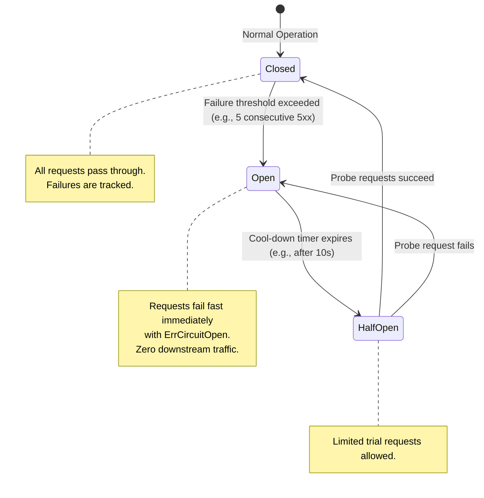

+++
title = "Project Plan 06 — Resilient Communication Library (Project 13)"
domain = "Golang"
tier = 3
topics = ["golang", "resilience", "http-client", "circuit-breaker", "retries", "exponential-backoff"]
parent = "docs/Golang/README.md"
children = []
related = [
    "docs/architecture/architecture.md",
    "docs/Golang/00-cloud-run-backend-go.md",
    "docs/Golang/05-opentelemetry-observability.md"
]
updated_by = "Antigravity AI"
version = "1.0"
+++

> **Parent**: [`docs/Golang/README.md`](file:///home/pochitawork/InterviewCloudProjects/ApigeeChallenge/docs/Golang/README.md)
> **Manifest**: [`AI_MANIFEST.toml`](file:///home/pochitawork/InterviewCloudProjects/ApigeeChallenge/AI_MANIFEST.toml)
> **Roadmap Ref**: Project 13 in [`golang_cloud_platform_portfolio_roadmap.md`](file:///home/pochitawork/InterviewCloudProjects/golang_cloud_platform_portfolio_roadmap.md)

<!-- AI RETRIEVAL HINTS:
- Purpose: Technical specification for a reusable Go HTTP client library featuring retries with exponential backoff, jitter, circuit breakers, and context cancellation.
- Questions Answered: How to prevent cascading failures between distributed services? How to safely implement retries for idempotent vs non-idempotent HTTP methods?
- When to Retrieve: Designing service-to-service communication or fault-tolerance mechanisms.
-->

# Project 06 — Resilient Communication Library (Project 13)

## 1. Problem Statement & Strategic Fit

In distributed microservice and hybrid cloud environments, transient network failures, cold starts, and brief downstream brownouts are inevitable. Naive HTTP clients without robust fault-tolerance mechanisms can cause:
1. **Thundering Herd & Cascading Outages**: Blind, immediate retries overwhelm recovering backends.
2. **Resource Starvation**: Unbounded request timeouts exhaust Goroutines and TCP socket connection pools.
3. **Unintended Side-Effects**: Retrying non-idempotent mutations (e.g., POST payments) can create duplicate transactions.

This project delivers `resilienthttp`, a production-grade, reusable Go client library designed to govern all internal and outbound communication from the Apigee Challenge backend.

---

## 2. Resilience Mechanisms & State Machine



### Core Capabilities:
- **Exponential Backoff with Full Jitter**: Randomizes retry delays (`t = rand(0, base * 2^attempt)`) to prevent synchronized bursts.
- **Circuit Breaker**: Detects downstream failure cascades and fails fast immediately without placing load on failing dependencies.
- **Strict Idempotency Guard**: By default, only safe HTTP methods (`GET`, `HEAD`, `OPTIONS`, `PUT`, `DELETE`) are eligible for automatic retries. `POST` requests are only retried if an explicit idempotency key or caller override is provided.
- **Connection Pool Tuning**: Pre-configures keep-alive pools (`MaxIdleConns`, `IdleConnTimeout`) to eliminate TCP/TLS handshake latency on repeated calls.

---

## 3. Package Architecture & Directory Structure

Proposed location: `pkg/resilienthttp/`

```text
pkg/resilienthttp/
├── client.go                 # Primary Client struct wrapping http.Client
├── options.go                # Functional options (WithRetries, WithTimeout, WithBreaker)
├── backoff.go                # Exponential backoff calculation with Decorrelated Jitter
├── circuit_breaker.go        # Thread-safe circuit breaker implementation
├── transport.go              # Custom http.RoundTripper injecting tracing and retries
├── errors.go                 # Typed errors (ErrCircuitOpen, ErrMaxRetriesExceeded)
├── client_test.go            # Comprehensive unit tests with httptest servers
└── benchmark_test.go         # Allocation and throughput benchmarks
```

---

## 4. Key Implementation Patterns

### 4.1 Functional Options Configuration
```go
type ClientConfig struct {
    Timeout        time.Duration
    MaxRetries     int
    InitialBackoff time.Duration
    MaxBackoff     time.Duration
    BreakerEnabled bool
}

type Option func(*ClientConfig)

func WithRetries(maxRetries int, initial time.Duration) Option {
    return func(c *ClientConfig) {
        c.MaxRetries = maxRetries
        c.InitialBackoff = initial
    }
}
```

### 4.2 Idempotency-Aware RoundTripper
```go
func (t *ResilientRoundTripper) RoundTrip(req *http.Request) (*http.Response, error) {
    if !t.circuitBreaker.Allow() {
        return nil, ErrCircuitOpen
    }

    var resp *http.Response
    var err error

    for attempt := 0; attempt <= t.maxRetries; attempt++ {
        // Enforce context deadline
        resp, err = t.baseTransport.RoundTrip(req)
        
        // Determine retry eligibility
        if !t.isRetryable(req.Method, resp, err) {
            break
        }
        
        sleepDuration := t.calculateBackoff(attempt)
        select {
        case <-time.After(sleepDuration):
        case <-req.Context().Done():
            return nil, req.Context().Err()
        }
    }

    t.circuitBreaker.RecordResult(err == nil && resp.StatusCode < 500)
    return resp, err
}
```

---

## 5. Verification & Test Strategy

### Automated Unit Tests
- Use `httptest.NewServer` to simulate a flapping backend that fails 3 times with `503` before returning `200 OK`. Confirm `resilienthttp` successfully returns the 200 response on attempt 4.
- Simulate an enduring outage: verify circuit breaker transitions to `Open` state after 5 failures and immediately rejects the 6th call without invoking the network.
- Test context cancellation: cancel the parent context while in backoff sleep; verify the Goroutine exits promptly without leaking.

---

## 6. Portfolio Evidence Deliverables

- **Failure Simulation Log**: Output demonstrating retry attempts with increasing backoff jitter intervals followed by circuit trip.
- **Comparison Benchmark**: Latency and resource profile comparing standard `net/http` vs `resilienthttp` during downstream failure storms.
- **ADR 007**: Architectural Decision Record on client-side resilience vs relying solely on service mesh proxies.
