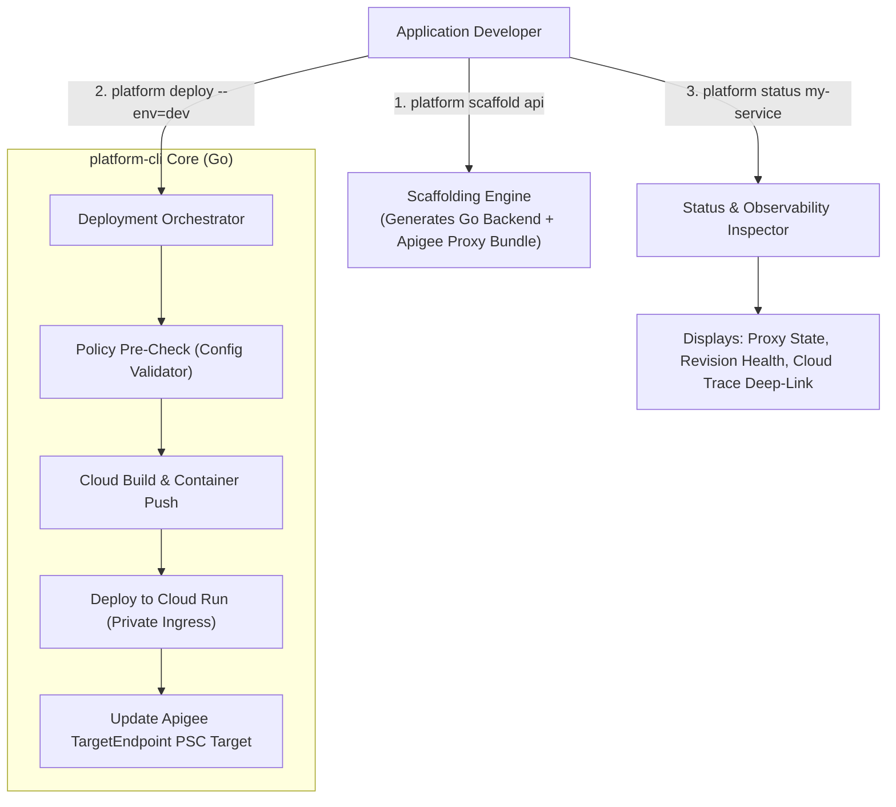

+++
title = "Project Plan 07 — Internal Developer Platform CLI (Project 15)"
domain = "Golang"
tier = 3
topics = ["golang", "idp", "platform-engineering", "cli", "self-service", "apigee", "cloud-run"]
parent = "docs/Golang/README.md"
children = []
related = [
    "docs/architecture/architecture.md",
    "docs/operations/deployment-runbook.md",
    "APPS/APIgee/"
]
updated_by = "Antigravity AI"
version = "1.0"
+++

> **Parent**: [`docs/Golang/README.md`](file:///home/pochitawork/InterviewCloudProjects/ApigeeChallenge/docs/Golang/README.md)
> **Manifest**: [`AI_MANIFEST.toml`](file:///home/pochitawork/InterviewCloudProjects/ApigeeChallenge/AI_MANIFEST.toml)
> **Roadmap Ref**: Project 15 in [`golang_cloud_platform_portfolio_roadmap.md`](file:///home/pochitawork/InterviewCloudProjects/golang_cloud_platform_portfolio_roadmap.md)

<!-- AI RETRIEVAL HINTS:
- Purpose: Technical plan for an Internal Developer Platform (IDP) self-service CLI tailored for Apigee and Cloud Run workflows.
- Questions Answered: How can developers scaffold compliant Apigee proxies, deploy mock backends, and inspect environment health through a single unified tool?
- When to Retrieve: Designing developer tooling, self-service portals, or platform automation.
-->

# Project 07 — Internal Developer Platform CLI (Project 15)

## 1. Problem Statement & Strategic Fit

Configuring enterprise API infrastructure involves complex, multi-step procedures across disparate tools: writing Apigee proxy XML bundles, creating Cloud Run container definitions, wiring Private Service Connect service attachments, and managing environment-specific variables.

For application developers, this cognitive load often results in misconfigured proxies, improper target endpoint definitions, or security policy bypasses.

This project introduces `platform-cli`, a Go-based developer self-service tool that abstracts these complexities. It enables software teams to scaffold, validate, deploy, and inspect end-to-end API services across Apigee and Cloud Run in minutes while enforcing corporate guardrails.

---

## 2. Developer Workflow & Interaction Flow



---

## 3. Command Surface & Developer Experience

```bash
# 1. Scaffold a new API service with standard security policies and Go backend
platform new api orders-service --template=rest-private

# 2. Deploy to development environment with automated policy verification
platform deploy orders-service --env=dev

# 3. Inspect end-to-end health (Apigee bundle status + Cloud Run revision)
platform status orders-service --env=dev

# 4. View aggregated real-time logs across Apigee Edge and Cloud Run container
platform logs orders-service --env=dev --follow

# 5. Rollback an errant release across both gateway and backend
platform rollback orders-service --env=dev
```

---

## 4. Component Architecture & Directory Structure

Proposed location: `tools/platform-cli/`

```text
tools/platform-cli/
├── cmd/
│   └── platform/
│       ├── main.go               # Cobra CLI entry point
│       ├── new.go                # Service scaffolding command
│       ├── deploy.go             # Deployment command
│       ├── status.go             # Status and observability links
│       └── rollback.go           # Coordinated rollback command
├── internal/
│   ├── templates/                # Embedded Go templates for Apigee XML & Go backends
│   │   ├── apigee/               # Proxies, policies, TargetEndpoints
│   │   └── backend/              # Go main.go, Dockerfile, go.mod
│   ├── gcp/
│   │   ├── apigee_client.go      # Apigee Management API client
│   │   ├── run_client.go         # Cloud Run client
│   │   └── logging_client.go     # Cloud Logging stream reader
│   ├── orchestrator/
│   │   └── pipeline.go           # Coordinates build -> deploy -> proxy bundle update
│   └── ui/
│       └── terminal.go           # Spinners, progress bars, colored terminal output
├── go.mod
├── go.sum
└── README.md
```

---

## 5. Key Implementation Patterns

### 5.1 Embedded Scaffolding (`embed.FS`)
```go
package templates

import "embed"

//go:embed all:apigee/* all:backend/*
var TemplateFS embed.FS

func RenderScaffold(serviceName string, targetDir string) error {
    // Walks TemplateFS, substitutes template placeholders ({{.ServiceName}}),
    // and writes files with appropriate permissions.
    return nil
}
```

### 5.2 Coordinated Release Orchestration
```go
func (p *Pipeline) Deploy(ctx context.Context, svc string, env string) error {
    // Step 1: Pre-flight check with embedded config validator
    if err := p.validator.Validate(svc, env); err != nil {
        return fmt.Errorf("pre-flight policy check failed: %w", err)
    }

    // Step 2: Build & Deploy Cloud Run backend
    revID, err := p.runClient.DeployContainer(ctx, svc, env)
    if err != nil {
        return fmt.Errorf("cloud run deployment failed: %w", err)
    }

    // Step 3: Wire TargetEndpoint in Apigee proxy bundle
    if err := p.apigeeClient.DeployProxyRevision(ctx, svc, env, revID); err != nil {
        // Rollback Cloud Run revision if proxy deployment fails
        _ = p.runClient.Rollback(ctx, svc, env)
        return fmt.Errorf("apigee deployment failed, rolled back backend: %w", err)
    }

    return nil
}
```

---

## 6. Verification & Test Strategy

### Automated Unit Tests
- Template rendering test: verify generated Go code passes `go vet` and generated Apigee XML validates against the Apigee XSD schema.
- Pipeline unit test: verify that if step 3 (Apigee deployment) fails, the rollback handler is automatically triggered.

### Manual Verification
- Execute `platform new api test-api`.
- Inspect the generated directory to verify that `TargetEndpoint.xml` properly references the Private Service Connect service attachment rather than a public URL.

---

## 7. Portfolio Evidence Deliverables

- **CLI Workflow Demo**: Video recording or terminal cast showing scaffolding to live deployment in under 60 seconds.
- **Developer Onboarding Guide**: Documentation showing how a developer provisions an API without manual console clicks.
- **ADR 008**: Architecture Decision Record on self-service developer platforms and balancing automation with security boundaries.
