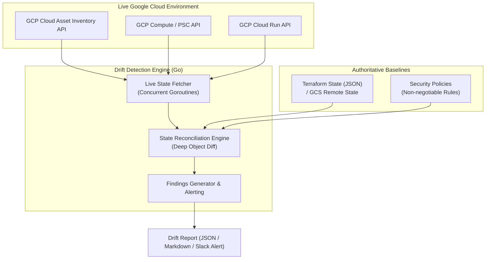

+++
title = "Project Plan 08 — Cloud Infrastructure Drift Detection Service (Project 16)"
domain = "Golang"
tier = 3
topics = ["golang", "drift-detection", "terraform", "cloud-asset-inventory", "security", "governance"]
parent = "docs/Golang/README.md"
children = []
related = [
    "docs/architecture/architecture.md",
    "docs/security/",
    "platform/GCP/terraform/"
]
updated_by = "Antigravity AI"
version = "1.0"
+++

> **Parent**: [`docs/Golang/README.md`](file:///home/pochitawork/InterviewCloudProjects/ApigeeChallenge/docs/Golang/README.md)
> **Manifest**: [`AI_MANIFEST.toml`](file:///home/pochitawork/InterviewCloudProjects/ApigeeChallenge/AI_MANIFEST.toml)
> **Roadmap Ref**: Project 16 in [`golang_cloud_platform_portfolio_roadmap.md`](file:///home/pochitawork/InterviewCloudProjects/golang_cloud_platform_portfolio_roadmap.md)

<!-- AI RETRIEVAL HINTS:
- Purpose: Architecture and technical plan for a continuous infrastructure drift detection engine comparing live GCP resources to Terraform state baselines.
- Questions Answered: How to detect unauthorized out-of-band mutations, public exposure leaks, or missing IAM guardrails in GCP?
- When to Retrieve: Designing compliance monitoring, drift remediation, or Cloud Asset Inventory audits.
-->

# Project 08 — Cloud Infrastructure Drift Detection Service (Project 16)

## 1. Problem Statement & Strategic Fit

Even when infrastructure is managed strictly via Terraform, manual out-of-band changes (e.g., an engineer temporarily opening an ingress firewall, making a Cloud Run service public, or altering an IAM role during an incident) frequently occur in cloud environments.

These modifications create **configuration drift**, degrading security posture and invalidating architecture guarantees.

This project implements `drift-detector`, a read-only Go reconciliation service that periodically queries the **Google Cloud Asset Inventory API** and resource-specific APIs, compares live configurations against approved Terraform state baselines, and generates actionable security findings.

---

## 2. Drift Detection Architecture & Reconciliation Flow



---

## 3. Targeted Drift Inspection Areas in Apigee Challenge

The engine focuses specifically on the critical boundaries of the Apigee Challenge topology:

| Monitored Component | Baseline Expectation | Detectable Drift / Violation | Severity |
|---|---|---|---|
| **Cloud Run Backend** | `ingress = "internal-and-cloud-load-balancing"` | Changed to `all` (accidental public exposure) | **CRITICAL** |
| **Cloud Run IAM** | Restricted to Apigee / PSC Service Account | `roles/run.invoker` granted to `allUsers` | **CRITICAL** |
| **Private Service Connect** | Target ILB attachment exists and matches subnet | Service attachment deleted or targeting invalid IP | **HIGH** |
| **Cloud Armor WAF** | Default rule: DENY, SQLi/XSS rules active | Rules disabled or priority reordered | **HIGH** |
| **Subnet CIDRs** | Subnet ranges match IP allocation plan | Subnets modified or non-RFC1918 ranges detected | **MEDIUM** |
| **Resource Labels** | Mandatory labels present (`environment`, `owner`) | Labels missing or altered | **LOW** |

---

## 4. Component Architecture & Directory Structure

Proposed location: `tools/drift-detector/`

```text
tools/drift-detector/
├── cmd/
│   └── drift-detector/
│       └── main.go               # Service entry point and cron scheduler
├── internal/
│   ├── baseline/
│   │   ├── tfstate_loader.go     # Reads terraform.tfstate from local disk or GCS
│   │   └── parser.go             # Normalizes Terraform resource definitions
│   ├── collector/
│   │   ├── asset_inventory.go    # Queries GCP Cloud Asset Inventory API
│   │   ├── cloudrun.go           # Directly queries Cloud Run Admin API
│   │   └── networking.go         # Inspects PSC attachments and Forwarding Rules
│   ├── reconciler/
│   │   ├── engine.go             # Compares normalized baseline vs live state
│   │   └── diff.go               # Deep structural difference evaluator
│   ├── findings/
│   │   ├── model.go              # Finding struct with Severity, Remedy, Evidence
│   │   └── exporter.go           # Exports to Cloud Logging, Webhook, or local JSON
│   └── testdata/                 # Seeded state fixtures for testing
├── go.mod
├── go.sum
└── README.md
```

---

## 5. Key Implementation Patterns

### 5.1 Finding Data Structure
```go
type Finding struct {
    ResourceID   string    `json:"resource_id"`
    ResourceType string    `json:"resource_type"`
    Severity     string    `json:"severity"` // CRITICAL, HIGH, MEDIUM, LOW
    Attribute    string    `json:"attribute"`
    Expected     any       `json:"expected_value"`
    Actual       any       `json:"actual_value"`
    DetectedAt   time.Time `json:"detected_at"`
    Remediation  string    `json:"remediation_steps"`
}
```

### 5.2 Concurrent Live State Collection
```go
func (c *Collector) FetchLiveState(ctx context.Context) (*LiveState, error) {
    g, ctx := errgroup.WithContext(ctx)
    state := &LiveState{}

    g.Go(func() error {
        runServices, err := c.fetchCloudRun(ctx)
        if err != nil { return err }
        state.CloudRun = runServices
        return nil
    })

    g.Go(func() error {
        pscAttachments, err := c.fetchPSC(ctx)
        if err != nil { return err }
        state.PSC = pscAttachments
        return nil
    })

    if err := g.Wait(); err != nil {
        return nil, fmt.Errorf("failed fetching GCP live state: %w", err)
    }
    return state, nil
}
```

---

## 6. Verification & Test Strategy

### Automated Seeded Drift Tests
- Create a baseline `tfstate` with `ingress = "internal-and-cloud-load-balancing"`.
- Provide a mock live asset object with `ingress = "all"`.
- Run the reconciliation engine: verify it generates exactly one **CRITICAL** finding identifying the exact attribute mutation.
- Provide identical baseline and live state: verify zero findings are produced (no false positives).

---

## 7. Portfolio Evidence Deliverables

- **Sample Drift Finding Report**: High-detail JSON and terminal table output showing detected drift.
- **Seeded Drift Experiment**: Documented step-by-step experiment showing an intentional manual GCP console modification immediately flagged by `drift-detector`.
- **ADR 009**: Architecture Decision Record on automated drift detection vs periodic `terraform plan` execution.
