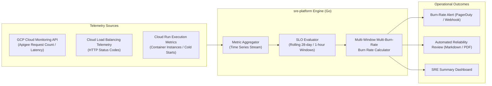

+++
title = "Project Plan 09 — Cloud Reliability Engineering Platform (Project 20)"
domain = "Golang"
tier = 3
topics = ["golang", "sre", "reliability", "slo", "sli", "error-budget", "observability"]
parent = "docs/Golang/README.md"
children = []
related = [
    "docs/architecture/architecture.md",
    "docs/operations/monitoring-and-logging.md",
    "docs/Golang/05-opentelemetry-observability.md"
]
updated_by = "Antigravity AI"
version = "1.0"
+++

> **Parent**: [`docs/Golang/README.md`](file:///home/pochitawork/InterviewCloudProjects/ApigeeChallenge/docs/Golang/README.md)
> **Manifest**: [`AI_MANIFEST.toml`](file:///home/pochitawork/InterviewCloudProjects/ApigeeChallenge/AI_MANIFEST.toml)
> **Roadmap Ref**: Project 20 in [`golang_cloud_platform_portfolio_roadmap.md`](file:///home/pochitawork/InterviewCloudProjects/golang_cloud_platform_portfolio_roadmap.md)

<!-- AI RETRIEVAL HINTS:
- Purpose: Architecture and technical plan for an automated SRE platform that evaluates SLIs, SLOs, and error budget burn rates for Apigee and Cloud Run.
- Questions Answered: How to calculate service level objectives (SLOs) and error budgets using GCP Cloud Monitoring metrics? How to configure multi-window multi-burn-rate alerts?
- When to Retrieve: Designing SRE frameworks, error-budget alerting, or reliability reporting.
-->

# Project 09 — Cloud Reliability Engineering Platform (Project 20)

## 1. Problem Statement & Strategic Fit

Traditional infrastructure alerting relies on static threshold checks (e.g., "CPU > 80%" or "memory > 90%"), which frequently cause alert fatigue or fail to catch actual customer-facing outages.

Modern Site Reliability Engineering (SRE) centers on **Service Level Indicators (SLIs)** and **Service Level Objectives (SLOs)** to measure user happiness and manage risk via an **Error Budget**.

This project implements `sre-platform`, a Go-based reliability service that continuously extracts telemetry from **Google Cloud Monitoring** (Apigee analytics, Load Balancer metrics, Cloud Run logs), computes rolling SLIs, calculates error budget burn rates according to the Google SRE Workbook standard, and generates automated reliability reports.

---

## 2. SLI / SLO Framework for Apigee Challenge



### Defined Service Level Objectives (SLOs):

| Service Boundary | SLI Specification | Objective (Target) | Evaluation Window |
|---|---|---|---|
| **Apigee Edge Gateway** | Ratio of non-5xx responses to total valid requests | **99.9% Availability** | 28-day rolling |
| **Apigee Edge Latency** | Ratio of requests served in < 250ms to total requests | **95.0% < 250ms** | 28-day rolling |
| **Cloud Run Backend** | Ratio of non-5xx responses received by PSC endpoint | **99.95% Availability**| 28-day rolling |
| **PSC Southbound Transit**| Round-trip network transit latency across PSC attachment | **99.0% < 20ms** | 28-day rolling |

---

## 3. Multi-Window Multi-Burn-Rate Alerting

Following Google SRE best practices, the platform implements multi-window burn rate detection to eliminate false positives while alerting quickly on critical outages:

- **14.4x Burn Rate (Consumes 2% budget in 1 hour)**: Critical Page (1-hour short window + 5-minute confirmation window).
- **6x Burn Rate (Consumes 5% budget in 6 hours)**: Ticket / Slack alert (6-hour long window + 30-minute confirmation window).

---

## 4. Component Architecture & Directory Structure

Proposed location: `tools/sre-platform/`

```text
tools/sre-platform/
├── cmd/
│   └── sre-platform/
│       └── main.go               # Service daemon and periodic evaluator
├── internal/
│   ├── gcp/
│   │   └── monitoring.go         # Cloud Monitoring API client (v3)
│   ├── slo/
│   │   ├── definitions.go        # SLI/SLO schema and target models
│   │   ├── evaluator.go          # Windowed calculation logic
│   │   └── burn_rate.go          # Multi-window burn rate math
│   ├── alerting/
│   │   ├── dispatcher.go         # Webhook and alert notifier
│   │   └── templates.go          # Alert message formatter
│   └── reporting/
│       ├── generator.go          # Markdown reliability report writer
│       └── export.go             # Storage of periodic reports
├── go.mod
├── go.sum
└── README.md
```

---

## 5. Key Implementation Patterns

### 5.1 Error Budget Math
```go
type SLOResult struct {
    Name             string
    Target           float64 // e.g. 0.999
    Observed         float64 // e.g. 0.9985
    ErrorBudgetTotal float64 // 1 - Target (0.001)
    BudgetConsumed   float64 // (1 - Observed) / ErrorBudgetTotal (1.5 = 150%)
    RemainingBudget  float64 // 1 - BudgetConsumed (-50%)
    BurnRate         float64
}

func CalculateBurnRate(goodCount, totalCount float64, target float64, windowHours float64) float64 {
    if totalCount == 0 {
        return 0.0
    }
    actualErrorRate := (totalCount - goodCount) / totalCount
    allowedErrorRate := 1.0 - target
    return actualErrorRate / allowedErrorRate
}
```

---

## 6. Verification & Test Strategy

### Automated Seeded Telemetry Tests
- Generate synthetic Cloud Monitoring time series fixtures representing an outage (e.g., 500 consecutive 500 errors).
- Verify the evaluator triggers the 14.4x burn rate alert within the simulated 5-minute confirmation period.
- Verify that a steady 99.95% traffic stream reports healthy error budgets (> 90% remaining) without emitting alerts.

---

## 7. Portfolio Evidence Deliverables

- **Sample SRE Reliability Report**: Markdown and HTML summary calculating 28-day availability, latency percentiles, and remaining error budget.
- **Burn-Rate Alert Simulation Log**: Output demonstrating multi-window alert trigger and recovery.
- **ADR 010**: Architecture Decision Record on SLO-based alerting vs static threshold alerting.
