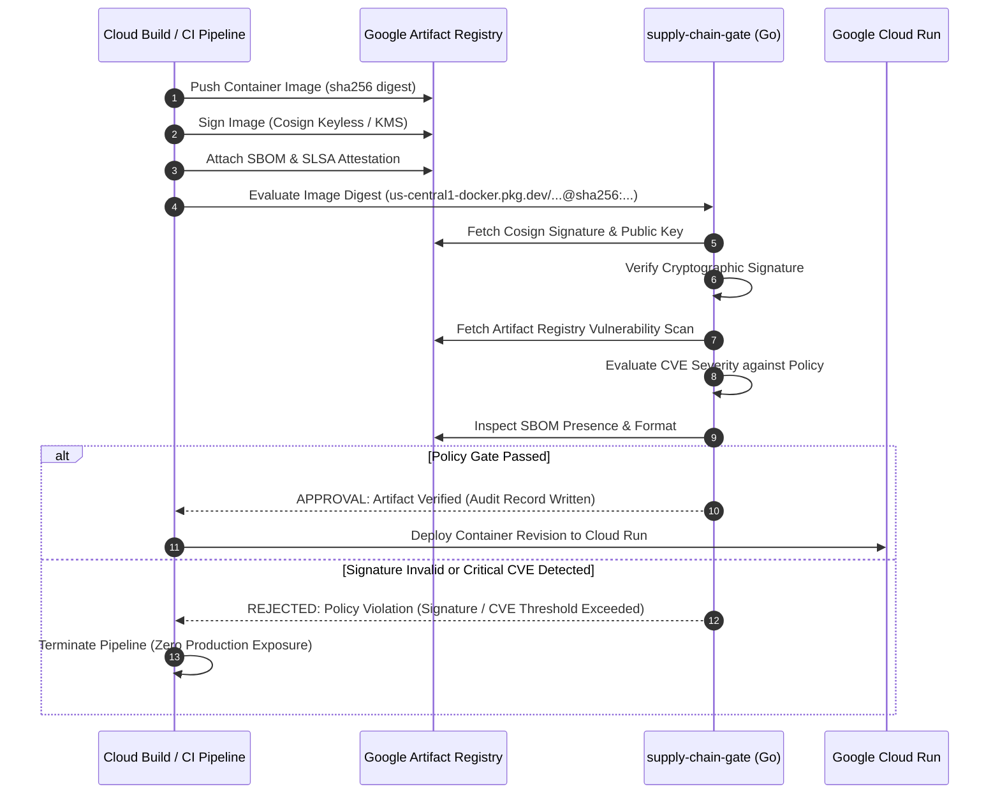

+++
title = "Project Plan 10 — Supply Chain Security Platform (Project 21)"
domain = "Golang"
tier = 3
topics = ["golang", "security", "supply-chain", "cosign", "sbom", "vulnerability-scanning", "slsa"]
parent = "docs/Golang/README.md"
children = []
related = [
    "docs/security/",
    "docs/Golang/00-cloud-run-backend-go.md",
    "docs/Golang/03-cloud-run-deployment-manager.md"
]
updated_by = "Antigravity AI"
version = "1.0"
+++

> **Parent**: [`docs/Golang/README.md`](file:///home/pochitawork/InterviewCloudProjects/ApigeeChallenge/docs/Golang/README.md)
> **Manifest**: [`AI_MANIFEST.toml`](file:///home/pochitawork/InterviewCloudProjects/ApigeeChallenge/AI_MANIFEST.toml)
> **Roadmap Ref**: Project 21 in [`golang_cloud_platform_portfolio_roadmap.md`](file:///home/pochitawork/InterviewCloudProjects/golang_cloud_platform_portfolio_roadmap.md)

<!-- AI RETRIEVAL HINTS:
- Purpose: Architecture and implementation plan for a Go supply chain security admission gate verifying container signatures, SBOMs, and vulnerability scans before Cloud Run deployment.
- Questions Answered: How to enforce SLSA provenance, verify Cosign cryptographic signatures, and gate container deployments based on vulnerability severity?
- When to Retrieve: Designing container security, supply chain pipelines, or admission control.
-->

# Project 10 — Supply Chain Security Platform (Project 21)

## 1. Problem Statement & Strategic Fit

Cloud container deployments are vulnerable to supply chain attacks: malicious image tampering in transit, untracked open-source dependencies, and deployment of images containing critical unpatched Common Vulnerabilities and Exposures (CVEs).

While GCP provides Artifact Registry and Binary Authorization, enterprise teams often require custom, transparent admission controls and verification tooling that seamlessly integrate with CI/CD and self-service deployment CLIs.

This project implements `supply-chain-gate`, a Go validation engine that evaluates container images and deployment metadata before Cloud Run release. It enforces that every deployed image is:
1. Cryptographically signed using **Sigstore / Cosign** with a trusted root of trust.
2. Accompanied by a compliant Software Bill of Materials (**SBOM**) in SPDX or CycloneDX format.
3. Free of unapproved Critical/High CVEs according to vulnerability scanning policies.
4. Bound by verified **SLSA Provenance** attestations.

---

## 2. Supply Chain Verification Flow & Admission Gate



---

## 3. Policy Rule Matrix

| Policy Dimension | Requirement | Failure Action |
|---|---|---|
| **Cryptographic Signature** | Must possess valid Cosign signature signed by authorized GCP Service Account / KMS Key | Immediate Reject (`ERROR_UNSIGNED_ARTIFACT`) |
| **Vulnerability Threshold** | 0 Critical CVEs, 0 High CVEs with available fix | Immediate Reject (`ERROR_VULNERABILITY_THRESHOLD`) |
| **SBOM Presence** | Must attach valid CycloneDX (JSON) or SPDX (JSON) bill of materials | Immediate Reject (`ERROR_MISSING_SBOM`) |
| **Base Image Compliance** | Must build on approved base image (`gcr.io/distroless/static-debian12`) | Immediate Reject (`ERROR_UNAPPROVED_BASE_IMAGE`) |
| **Provenance** | SLSA Level 2+ build provenance generated by Google Cloud Build | Warning in Dev, Reject in Prod |

---

## 4. Component Architecture & Directory Structure

Proposed location: `tools/supply-chain/`

```text
tools/supply-chain/
├── cmd/
│   └── supply-chain-gate/
│       └── main.go               # CLI entry point for CI/CD gates
├── internal/
│   ├── verifier/
│   │   ├── signature.go          # Sigstore / Cosign signature verification (sigstore/cosign/v2)
│   │   ├── attestation.go        # SLSA in-toto statement parser
│   │   └── sbom.go               # CycloneDX / SPDX parser and component auditor
│   ├── scanner/
│   │   └── gcp_containeranalysis.go # Queries GCP Container Analysis API for CVEs
│   ├── policy/
│   │   ├── engine.go             # Rule engine matching findings against policy config
│   │   └── policy_schema.go      # YAML policy definition schema
│   ├── audit/
│   │   └── attestor.go           # Creates cryptographically signed deployment approval token
│   └── testdata/                 # Signed & tampered test container fixtures
├── go.mod
├── go.sum
└── README.md
```

---

## 5. Key Implementation Patterns

### 5.1 Cosign Signature Verification (Go SDK)
```go
package verifier

import (
    "context"
    "fmt"
    "github.com/google/go-containerregistry/pkg/name"
    "github.com/sigstore/cosign/v2/pkg/cosign"
    "github.com/sigstore/sigstore/pkg/signature"
)

type SignatureVerifier struct {
    verifier signature.Verifier
}

func (s *SignatureVerifier) VerifyImage(ctx context.Context, imageRef string) error {
    ref, err := name.ParseReference(imageRef)
    if err != nil {
        return fmt.Errorf("invalid image reference: %w", err)
    }

    checkOpts := &cosign.CheckOpts{
        SigVerifier: s.verifier,
    }

    signatures, bundleVerified, err := cosign.VerifyImageSignatures(ctx, ref, checkOpts)
    if err != nil {
        return fmt.Errorf("signature verification failed: %w", err)
    }

    if len(signatures) == 0 || !bundleVerified {
        return fmt.Errorf("no verified signatures found for image %s", imageRef)
    }

    return nil
}
```

---

## 6. Verification & Test Strategy

### Automated Unit Tests
- Create a test fixture with an altered digest; verify signature verification immediately returns failure.
- Create a synthetic Container Analysis report containing 1 Critical CVE (`CVE-2023-XXXX`); verify the policy engine correctly blocks deployment.
- Verify that valid signed images with zero Critical CVEs return exit code `0` and write an audit log entry.

---

## 7. Portfolio Evidence Deliverables

- **Supply Chain Architecture Diagram**: High-fidelity map showing source code commit -> Cloud Build -> Cosign Signing -> Admission Gate -> Cloud Run.
- **Audit Verification Log**: Demonstration of rejected unsigned artifact followed by successful verified deployment.
- **ADR 011**: Architecture Decision Record on client-side supply chain gating vs reliance on native managed admission controls.
