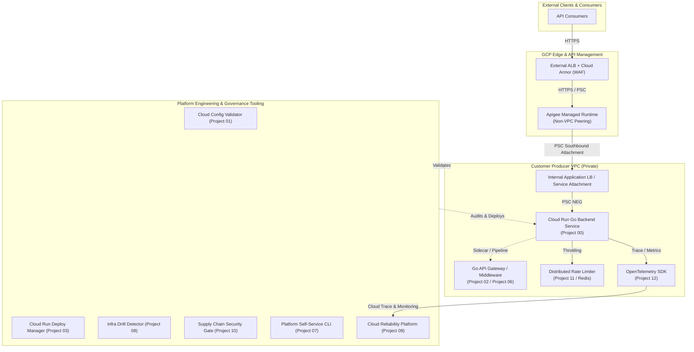

+++
title = "Golang Cloud Platform Portfolio Roadmap — Apigee Challenge"
domain = "Golang"
tier = 2
topics = ["golang", "portfolio", "cloud-run", "apigee", "platform-engineering", "sre", "security", "roadmap"]
parent = "README.md"
children = [
    "docs/Golang/00-cloud-run-backend-go.md",
    "docs/Golang/01-cloud-configuration-validator.md",
    "docs/Golang/02-go-api-gateway-middleware.md",
    "docs/Golang/03-cloud-run-deployment-manager.md",
    "docs/Golang/04-distributed-rate-limiter.md",
    "docs/Golang/05-opentelemetry-observability.md",
    "docs/Golang/06-resilient-communication-library.md",
    "docs/Golang/07-internal-developer-platform-cli.md",
    "docs/Golang/08-infrastructure-drift-detection.md",
    "docs/Golang/09-cloud-reliability-platform.md",
    "docs/Golang/10-supply-chain-security.md"
]
related = [
    "docs/architecture/architecture.md",
    "docs/decisions/architecture-decisions.md",
    "docs/architecture/CloudRun/CloudRun-requirements.md",
    "AI_MANIFEST.toml"
]
updated_by = "Antigravity AI"
version = "1.0"
+++

> **Parent**: [`README.md`](file:///home/pochitawork/InterviewCloudProjects/ApigeeChallenge/README.md)
> **Manifest**: [`AI_MANIFEST.toml`](file:///home/pochitawork/InterviewCloudProjects/ApigeeChallenge/AI_MANIFEST.toml)
> **Architecture**: [`architecture.md`](file:///home/pochitawork/InterviewCloudProjects/ApigeeChallenge/docs/architecture/architecture.md)
> **Decisions**: [`architecture-decisions.md`](file:///home/pochitawork/InterviewCloudProjects/ApigeeChallenge/docs/decisions/architecture-decisions.md)

<!-- AI RETRIEVAL HINTS:
- Purpose: Master navigation and strategic plan for expanding the Apigee Challenge repository with idiomatic Go (Golang) cloud, platform, and distributed systems components.
- Questions Answered: Which Go projects from the master portfolio roadmap apply to Apigee Challenge? What is the prioritization matrix? How do Go components integrate with Apigee, Private Service Connect (PSC), and Cloud Run?
- When to Retrieve: Planning Go additions, selecting portfolio projects, understanding boundaries between Apigee edge management and Go backend/tooling components.
- When NOT to Retrieve: When only Terraform IaC or pure Apigee proxy XML configurations are needed without Go integration.
-->

# Golang Cloud Platform Portfolio Roadmap — Apigee Challenge

## 1. Executive Summary & Purpose

This documentation suite establishes the roadmap and architectural specifications for integrating **Go (Golang)** into the **Apigee Challenge** repository.

The master reference document is [`golang_cloud_platform_portfolio_roadmap.md`](file:///home/pochitawork/InterviewCloudProjects/golang_cloud_platform_portfolio_roadmap.md). The Apigee Challenge repository represents an enterprise GCP hybrid cloud API exposure platform:
- **Northbound Ingress**: Regional External Application Load Balancer + Google Cloud Armor (WAF).
- **API Runtime**: Managed Google Cloud Apigee (Non-VPC Peering model).
- **Southbound Transit**: Private Service Connect (PSC) targeting an Internal Load Balancer / PSC NEG in a private customer VPC.
- **Backend Service**: Serverless container on Cloud Run with Private Google Access.
- **Hybrid Reachability**: Cloud VPN connecting to on-premises networks.

By strategically introducing Go across application runtimes, operational CLIs, distributed coordination, and platform governance, this repository demonstrates measurable senior-level capabilities in **Cloud Application Development, Platform Engineering, Distributed Systems, Reliability Engineering (SRE), and Cloud Security**.

---

## 2. Core Architectural Principles

When implementing Go components in this repository, follow these core principles:

1. **Preserve Apigee Edge Responsibilities**: Do not duplicate features best managed by Apigee (public OAuth/SAML token issuance, API developer portal, consumer analytics, public rate limiting). Use Go for backend services, specialized internal middleware, platform tooling, and deep service instrumentation.
2. **Respect the PSC Perimeter**: Southbound traffic from Apigee arrives over Private Service Connect. Go backends must honor PSC endpoint headers, TLS termination, and health check conventions.
3. **Keep Terraform as Authoritative IaC**: Go utilities validate, inspect, and drift-check infrastructure, but do not replace Terraform as the provisioning engine.
4. **Build Measurable Evidence**: Every project must provide test suites, benchmarks, failure injection results, and Architecture Decision Records (ADRs).
5. **No Blind Rewrites**: Go components are added where Go offers distinct concurrency, type-safety, single-binary distribution, or memory efficiency advantages.

---

## 3. High-Level System Architecture



---

## 4. Master Project Inventory & Priority Matrix

The roadmap identifies **11 targeted Go projects** categorized across 5 capability levels:

| Document | Project Name | Capability Level | Priority | Estimated Effort | Key Deliverable |
|---|---|---|---|---|---|
| [`00-cloud-run-backend-go.md`](file:///home/pochitawork/InterviewCloudProjects/ApigeeChallenge/docs/Golang/00-cloud-run-backend-go.md) | **Cloud Run Go Backend Service** | Core Service | **P1 (Immediate)** | 3–5 days | Production-grade Go backend replacing Node.js baseline |
| [`01-cloud-configuration-validator.md`](file:///home/pochitawork/InterviewCloudProjects/ApigeeChallenge/docs/Golang/01-cloud-configuration-validator.md) | **Cloud Configuration Validator** | Level 1 (Fundamentals) | **P1 (Immediate)** | 2–4 days | Pre-deployment CLI validating tfvars, labels, CIDRs, and security policies |
| [`02-go-api-gateway-middleware.md`](file:///home/pochitawork/InterviewCloudProjects/ApigeeChallenge/docs/Golang/02-go-api-gateway-middleware.md) | **Go API Gateway / Middleware** | Level 2 (Cloud Apps) | **P2 (Near-Term)** | 1–2 weeks | Backend routing, internal JWT assertions, request ID correlation |
| [`03-cloud-run-deployment-manager.md`](file:///home/pochitawork/InterviewCloudProjects/ApigeeChallenge/docs/Golang/03-cloud-run-deployment-manager.md) | **Cloud Run Deployment Manager** | Level 2 (Cloud Apps) | **P2 (Near-Term)** | 1–2 weeks | CLI for safe canary rollouts, traffic splitting, and instant rollbacks |
| [`04-distributed-rate-limiter.md`](file:///home/pochitawork/InterviewCloudProjects/ApigeeChallenge/docs/Golang/04-distributed-rate-limiter.md) | **Distributed Rate Limiter** | Level 3 (Distributed) | **P3 (Mid-Term)** | 2 weeks | Redis-backed token bucket / sliding window multi-tenant limiter |
| [`05-opentelemetry-observability.md`](file:///home/pochitawork/InterviewCloudProjects/ApigeeChallenge/docs/Golang/05-opentelemetry-observability.md) | **OpenTelemetry Observability** | Level 3 (Distributed) | **P1 (Immediate)** | 2–3 weeks | End-to-end W3C trace propagation from Apigee to Cloud Run & Cloud Trace |
| [`06-resilient-communication-library.md`](file:///home/pochitawork/InterviewCloudProjects/ApigeeChallenge/docs/Golang/06-resilient-communication-library.md) | **Resilient Communication Library** | Level 3 (Distributed) | **P2 (Near-Term)** | 2 weeks | Reusable HTTP client with bounded retries, jitter, circuit breakers |
| [`07-internal-developer-platform-cli.md`](file:///home/pochitawork/InterviewCloudProjects/ApigeeChallenge/docs/Golang/07-internal-developer-platform-cli.md) | **Internal Developer Platform CLI** | Level 4 (Platform) | **P3 (Mid-Term)** | 3–4 weeks | Developer self-service CLI scaffolding Apigee proxies and Cloud Run backends |
| [`08-infrastructure-drift-detection.md`](file:///home/pochitawork/InterviewCloudProjects/ApigeeChallenge/docs/Golang/08-infrastructure-drift-detection.md) | **Infra Drift Detection Service** | Level 4 (Platform) | **P2 (Near-Term)** | 3–4 weeks | Reconciler detecting state drift in PSC endpoints, Cloud Run, and IAM |
| [`09-cloud-reliability-platform.md`](file:///home/pochitawork/InterviewCloudProjects/ApigeeChallenge/docs/Golang/09-cloud-reliability-platform.md) | **Cloud Reliability Platform (SRE)** | Level 5 (Architecture) | **P4 (Advanced)** | 4–6 weeks | SLI/SLO evaluation engine, error-budget burn-rate monitoring & alerting |
| [`10-supply-chain-security.md`](file:///home/pochitawork/InterviewCloudProjects/ApigeeChallenge/docs/Golang/10-supply-chain-security.md) | **Supply Chain Security Platform** | Level 5 (Architecture) | **P3 (Mid-Term)** | 4–6 weeks | Cosign image signature verification, SBOM validation, vulnerability gating |

---

## 5. Suggested Repository Layout

To cleanly house these Go components alongside existing Terraform and Apigee artifacts without collision, the following directory structure is planned:

```text
ApigeeChallenge/
├── APPS/
│   ├── APIgee/                 # Managed Apigee proxies & bundles
│   └── RAW-containers/         # Existing Node.js container baseline
├── backend/
│   └── go/                     # Project 00: Cloud Run Go Backend Service
│       ├── cmd/server/         # Main entry point
│       ├── internal/api/       # HTTP handlers, routing, middleware
│       ├── internal/config/    # Environment configuration & validation
│       ├── internal/telemetry/ # OpenTelemetry integration
│       └── Dockerfile          # Distroless / Scratch multistage build
├── tools/                      # Standalone Go CLIs & Services
│   ├── cloud-validator/        # Project 01: Cloud Configuration Validator
│   ├── cloud-deploy/           # Project 03: Cloud Run Deployment Manager
│   ├── drift-detector/         # Project 08: Infrastructure Drift Detector
│   ├── platform-cli/           # Project 07: Internal Developer Platform CLI
│   ├── rate-limiter/           # Project 04: Distributed Rate Limiter
│   ├── sre-platform/           # Project 09: Cloud Reliability Platform
│   └── supply-chain/           # Project 10: Supply Chain Security Gate
├── pkg/                        # Shared Go libraries
│   ├── resilienthttp/          # Project 06: Resilient Communication Library
│   └── telemetry/              # Project 05: OpenTelemetry tracing/metrics helpers
└── docs/
    └── Golang/                 # This planning and specification suite
```

---

## 6. Definition of Done for Go Implementations

Every Go project implemented in this repository must satisfy the roadmap's universal quality baseline:

- [ ] **Idiomatic Go**: Clean architecture with explicit package boundaries (`cmd/`, `internal/`, `pkg/`).
- [ ] **Configuration**: Environment variables or YAML loaded with context and strict type checking; no hardcoded credentials.
- [ ] **Context Propagation**: Every network call, database query, and background job accepts `context.Context`.
- [ ] **Error Handling**: Explicit errors wrapped with descriptive context (`fmt.Errorf("failed to fetch service: %w", err)`).
- [ ] **Testing**:
  - Unit tests with table-driven tests (`go test ./...`).
  - Race detector clean (`go test -race ./...`).
  - Integration tests with hermetic test doubles or mock GCP servers.
  - Failure path tests (network timeout, 500 error, malformed input).
- [ ] **Containerization**: Multistage Dockerfile using `gcr.io/distroless/static-debian12:nonroot` or `scratch`, running as non-root user.
- [ ] **Observability**: Structured JSON logging (`log/slog`), health endpoints (`/healthz`, `/ready`), and OpenTelemetry tracing.
- [ ] **Security**: Least-privilege GCP IAM, no secrets logged or embedded in binaries.
- [ ] **Evidence**: Verified runbooks, benchmark results, test output, and Architecture Decision Records (ADRs).
